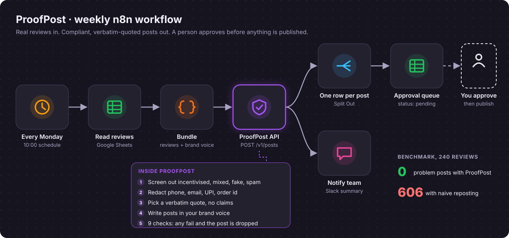

# ProofPost


**Turn real customer reviews into compliant, on-brand social posts, every week, automatically.**
ProofPost reads your review exports (Google, Shopify review apps, Amazon or any sheet), picks the reviews that are safe and worth sharing, quotes them **word for word**, writes Instagram, LinkedIn and X posts in your brand voice, and drops them into an approval sheet. A person approves; nothing is published on its own.



## Why brands need it

Reviews are the cheapest, most trusted marketing a D2C brand has. Reposting them by hand is slow, and reposting them carelessly is risky:

| What goes wrong when reviews are reposted by hand | Why it matters in India | ProofPost |
|---|---|---|
| Customer's phone, email, UPI id or order number left in the post | Personal data under the DPDP Act | Redacted before anything else runs |
| Full name posted without permission | Same; also trust | "First L." only with consent, else "Verified buyer" |
| "It cured my acne", "lost 5 kg", "100% safe" reposted by the brand | The brand now makes a claim it cannot substantiate (ASCI) | Claim sentences are never quoted; claim-only reviews are skipped |
| Free-product or review-for-discount reviews reused as organic praise | Undisclosed incentives (IS 19000:2022 on online reviews) | Detected and excluded |
| 5 stars, but "arrived damaged" inside | Looks like the brand hides problems | Mixed reviews excluded |
| The same text from several "customers" | Likely fake reviews | Duplicates excluded |
| Quote "tidied up" by a copywriter or an AI | A reworded quote is a fabricated quote | Quotes are exact substrings, verified by a check |

**Who buys this:** D2C brands with a steady flow of reviews (skincare, coffee, apparel, home), and social media agencies running content for many such brands.

## Results

`python -m proofpost.evaluate` builds 240 labelled reviews per set with the traps above and compares ProofPost with the naive approach (take every 4 to 5 star review, post the full text, credit the customer by name). The **held-out** set uses phrasing written separately and never used to tune the rules. CI runs it on every push and fails on a single problem post.

| | Naive repost | ProofPost (dev) | ProofPost (held-out) |
|---|---|---|---|
| Posts produced (3 platforms) | 660 | 303 | 303 |
| **Posts with any problem** | **606** | **0** | **0** |
| Reviews used that were safe to use | 46% | 100% | 100% |
| Safe reviews turned into posts | 100% | 100% | 100% |

| Problem (posts) | Naive | ProofPost dev | ProofPost held-out |
|---|---|---|---|
| Personal data exposed | 60 | 0 | 0 |
| Health or absolute claims | 120 | 0 | 0 |
| Incentivised reviews reused | 60 | 0 | 0 |
| Mixed / negative reviews reused | 60 | 0 | 0 |
| Fake duplicates reused | 57 | 0 | 0 |
| Customer named without consent | 465 | 0 | 0 |
| Misquoted | 0 | 0 | 0 |

Throughput: about 3,800 reviews per second on a laptop CPU, no LLM needed.

## What a post looks like

Input review (Shopify export): *"Ordered the cold brew kit for my office. The aroma is incredible and delivery came in 2 days. Call me on 98xxxxxxxx if you want to know more!"*

```
☕ Flavour worth talking about.

“Ordered the cold brew kit for my office. The aroma is incredible and delivery came in 2 days.”

— Verified buyer ★★★★★

Try the cold brew kit, link in bio.

#Brewly #CoffeeLovers #CustomerLove #Taste
```

The phone number never reaches the post, the customer is not named (no consent), and the quote is the customer's own words.

## How it works

```mermaid
flowchart LR
    A[Reviews export or sheet] --> B[Map columns<br/>Google · Shopify · Amazon · CSV]
    B --> C[Screen<br/>rating · incentivised · mixed · spam · duplicates]
    C --> D[Redact personal data]
    D --> E[Pick a verbatim quote<br/>specific, no claims]
    E --> F[Compose per platform<br/>brand voice · limits · hashtags]
    F --> G[Final checks<br/>9 rules, fail = dropped]
    G --> H[Approval queue<br/>Google Sheet / Excel]
    H -->|human approves| I[Publish via Buffer, Meta Suite, LinkedIn]
```



| Design choice | Why |
|---|---|
| Quotes are exact substrings, never rewritten | Rewording a customer is fabricating a review |
| Optional LLM writes only the hook line | The quote never passes through a model; unsafe hooks fall back to templates |
| A post failing any check is dropped, not "fixed" | Silent fixes hide problems; the summary shows what was blocked |
| One post per customer, varied topics | A feed of ten near-identical "fast delivery" posts looks fake |
| Human approval is built in | Every post lands as `pending_approval`; nothing auto-publishes |
| Rejected reviews are logged with reasons | The team can see why a glowing review was held back |

## Run it with n8n (the automation)

```bash
docker compose up -d        # starts ProofPost API + n8n at http://localhost:5678
```

1. In n8n, import [`workflows/proofpost-weekly.json`](workflows/proofpost-weekly.json).
2. Connect Google Sheets (a **Reviews** tab and an **Approval queue** tab), Slack, and a Header Auth credential `X-API-Key` matching `PROOFPOST_API_KEYS`.
3. Edit the brand block in the **Bundle reviews + brand** node.

Every Monday at 10:00 it reads new reviews, sends them to ProofPost, appends the posts to the approval sheet and tells the team on Slack how many are waiting.

## Other ways to use it

```bash
pip install -e ".[app]" && streamlit run app.py      # demo with sample reviews
```

```bash
pip install -e .
proofpost data/samples/reviews_judgeme.csv --brand config/brand.example.yaml --out queue.xlsx
# 36 reviews -> 30 posts ready for approval, 20 reviews not used -> queue.xlsx
```

```bash
curl -X POST localhost:8000/v1/posts -H 'Content-Type: application/json' -H 'X-API-Key: change-me' \
  -d '{"reviews":[{"review":"Lovely aroma, delivery took 2 days.","rating":5}],"brand":{"name":"Brewly"}}'
```

Brand voice lives in YAML ([example](config/brand.example.yaml)): tone (warm, crisp, playful), emoji, hashtags, calls to action, banned words, and your own product aspects.

## Business model (suggested)

| Plan | For | What's included |
|---|---|---|
| Self-hosted | Tech-savvy brands | This repo, MIT licence |
| Managed | Brands without a tech team | Hosted API + n8n, weekly approval sheet, Slack alerts |
| Agency | Agencies with many brands | Multiple brand profiles, one approval queue per client |

The pitch is simple: a week of review posts in minutes, with the compliance checks a careful human would do and a record of what was held back and why.

## Limitations

- Rules are English-first. Hinglish and regional-language reviews need more phrasing coverage before they can be relied on.
- Sarcasm ("great, it broke on day one") is only caught when a negative cue word appears.
- Benchmark reviews are synthetic; validate on a sample of your own reviews before going live.
- Not legal advice. The checks reduce common risks; a person still approves every post.

## Project layout

```
src/proofpost/ingest.py    column mapping for Google, Shopify review apps, Amazon, any CSV
src/proofpost/screen.py    eligibility rules with reasons
src/proofpost/redact.py    phone, email, UPI, order id, address; consent-aware attribution
src/proofpost/quote.py     verbatim quote selection, claim sentences excluded
src/proofpost/compose.py   platform templates, limits, hashtags, brand voice
src/proofpost/guard.py     9 final checks per post
src/proofpost/llm.py       optional hook writer (Groq, Gemini, OpenRouter, Ollama)
src/proofpost/evaluate.py  benchmark vs naive reposting, held-out phrasing, CI gate
src/proofpost/api.py       FastAPI service the n8n workflow calls
workflows/                 importable n8n workflow
app.py                     Streamlit demo
```
